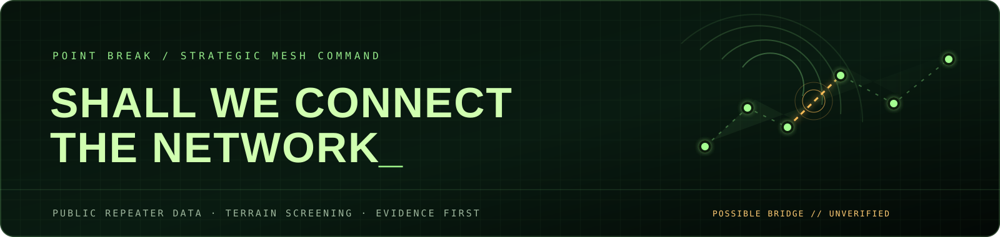
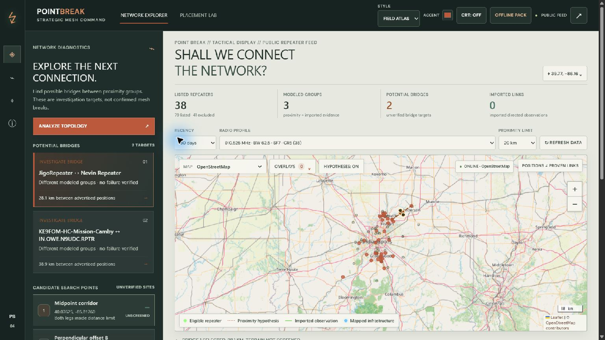
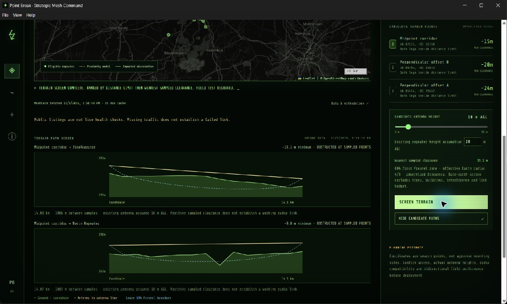
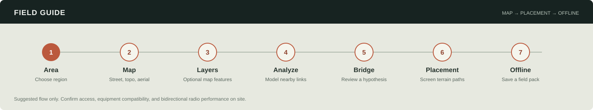

<p align="center">
  
</p>

<p align="center">
  <a href="https://github.com/njsnowman/point-break/actions/workflows/ci.yml"></a>
  <a href="https://github.com/njsnowman/point-break/actions/workflows/desktop.yml"></a>
</p>

# Point Break

**Strategic Mesh Command** is a WarGames-inspired MeshCore planning desk for exploring public repeater listings, finding *possible* topology gaps, and screening candidate relay locations against sampled terrain.

It turns public advertisements into a map, proximity hypotheses, and terrain profiles. It does **not** claim that a radio link is up, that a mesh is broken, or that a candidate site will work. Measured links can be imported separately as timestamped evidence.

## Get the Windows app

The `main` branch builds a Windows x64 installer and portable executable on every desktop-app change. The latest run is on [GitHub Actions](https://github.com/njsnowman/point-break/actions/workflows/desktop.yml). Open its newest successful **Windows desktop** run and download the **Point-Break-Windows-x64** artifact ZIP. The ZIP contains both `.exe` files.

- **Installer:** choose a per-user install folder and optionally add Start menu and desktop shortcuts.
- **Portable:** run without installing.

These builds are unsigned, so Windows may show a security prompt. Connect to collect MeshCore, map, infrastructure, and terrain data; save an area pack for offline field use. Action artifacts are retained for 30 days; build another from the workflow page when needed.

For installation and analysis instructions, see **[How to use Point Break](docs/HOW_TO.md)**.

## Screenshots

The screenshots below are from the Windows desktop app using live public data for Central Indiana. Counts and terrain results change as listings and settings change.

| Network explorer | Terrain screening |
| --- | --- |
|  |  |

The in-app Field Guide walks through the seven-step workflow:



## What it does

- Fetches public MeshCore type-2 repeater listings for a selected region.
- Filters nodes by recency and exact advertised radio profile.
- Maps advertised positions and draws distance-limited proximity hypotheses.
- Groups those hypothetical links and suggests short bridges between modeled groups for investigation.
- Generates three candidate search points and screens both legs with sampled terrain, Earth curvature, and the 60% first Fresnel zone.
- Opens in Field Atlas, a warm, high-contrast map workspace framed by dark field controls and restrained glass-finish panels. Choose a custom accent color or switch to Phosphor, Amber, Arctic, and Violet. Seven basemap choices include offline Field Grid, OpenStreetMap, Esri Streets, Esri Topographic, USGS Topo, Esri Aerial Imagery, and USGS Aerial + Topo.
- Loads mapped public antennas/towers, cellular/wireless sites, explicitly tagged amateur-radio infrastructure, and potential host structures from OpenStreetMap.
- Saves dated regional offline packs with MeshCore listings, loaded infrastructure, analysis settings, and available terrain profiles; imports and exports portable packs.
- Includes quick region presets for Central Indiana and CVG (Cincinnati / Northern Kentucky); users can save independent offline packs for both.
- Imports timestamped, directed repeater observations from a local JSON file, and exports the analysis as JSON.
- Guides new users through a visual seven-step flow: area, basemap, optional overlays, analysis, bridge selection, terrain screening, and offline preparation.

Offline packs preserve a snapshot for local analysis. The Field Grid and saved data work without a network connection; online basemaps, live feeds, and new elevation requests require internet. External map tiles are never bulk-downloaded or included in area packs. The browser app shell is cached after its first HTTPS visit, and the desktop app bundles it locally.

### Evidence labels matter

Public listings describe advertised positions and advert times, not current health. Dotted map links, modeled groups, bridge targets, and candidate coordinates are planning hypotheses. A missing link observation is not proof of a broken connection. Terrain profiles use sparse ground samples; they cannot see every tree, building, source-resolution artifact, or RF condition. Field testing, a radio link budget, and site access checks remain necessary.

## Run from source

Requires Node.js 22 or newer.

```sh
npm ci
npm run build
npm test
npm run dev
```

The local web preview is served at `http://localhost:8765`. For the desktop app, use `npm run desktop`. Build a Windows installer and portable executable with `npm run desktop:pack`; files are written to `release/`.

## How it is packaged

The Electron app loads the same interface and bundled API worker using the private `pointbreak://app/` protocol. It does not depend on the hosted Site or open a local HTTP port. The renderer runs with Node integration disabled, context isolation enabled, sandboxing enabled, and device permissions denied. External HTTPS links open in the system browser.

GitHub Actions runs the test suite and packages the Windows app from source. The generated `dist/` and `release/` directories are intentionally excluded from Git: `dist/` is reproducible, and the Windows binaries are distributed as the Actions artifact.

## Data, privacy, and limitations

- **MeshCore:** `https://map.meshcore.io/api/v1/nodes`. Regional results cache for 15 minutes. Upstream records are streamed and filtered; the selected region returns at most 500 nearest repeaters with a truncation notice.
- **Topology:** proximity requires an exact match on advertised frequency, bandwidth, spreading factor, and coding rate, plus the chosen recency and distance thresholds. It is a geometric model, not RF propagation analysis.
- **Terrain:** Open-Elevation is queried only when the terrain screen runs. Each candidate uses 15 ground samples on each leg. The screen applies a 4/3 effective Earth radius and 60% Fresnel clearance using advertised frequency and user-entered antenna heights.
- **Imported observations:** require full 64-character public keys, a direction, and a timezone-aware timestamp. Imports stay in the app session; there is no automatic observer feed.
- **Location:** Point Break does not request device location. The default region is Central Indiana; coordinates are sent to the elevation provider only for an explicit terrain screen.
- **Map:** Leaflet 1.9.4; OpenStreetMap, Esri, and USGS basemaps plus mapped public infrastructure; generated offline Field Grid. Attribution appears in the map. Tiles are not included in offline packs. See `web/vendor/LEAFLET-LICENSE`.

See [the full how-to guide](docs/HOW_TO.md) for data interpretation and troubleshooting.
